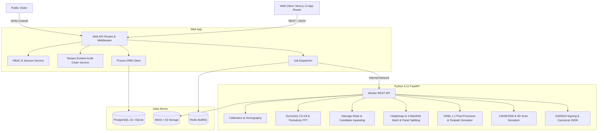

# NaqshLab System Architecture

## Subsystem Responsibilities

1. **`apps/web`**:
   - Modern Next.js App Router application with zero hardcoded strings (`next-intl` in `uz-Latn`, `ru`, `en`).
   - Server-side RBAC guards and CSRF protection.
   - Interactive 3D Three.js viewer with cross-section analysis, measurement caliper, and deviation overlay.
   - Vector reconstruction editor for segment inspection and motif candidate selection.
   - Workshop task tracking portal with photo verification.
   - Admin management dashboard and analytics.

2. **`apps/worker`**:
   - Python 3.11 FastAPI computational geometry engine.
   - OpenCV ArUco marker rectification and scale determination.
   - FFT 2D autocorrelation for rotational/translational repeat discovery.
   - Trimesh watertight mesh generation, chamfering, undercut checks, draft angle ($ \ge 2^\circ $) verification.
   - GRBL 1.1 CNC toolpath generator with bounding envelope ($300 \times 180$ mm) and maximum depth safety blocks.
   - Verified CIEDE2000 color difference engine matching Sharma et al. (2005).

3. **`packages/shared`**:
   - Single brand source of truth (`BRAND_NAME = "NaqshLab"`).
   - Replica statement constants (`NUSXA — ASL EMAS` and `REPLICA — NOT AN ORIGINAL`).
   - Shared TypeScript types, Zod schemas, design tokens, and i18n key definitions.

4. **`infra`**:
   - Docker Compose containing `web`, `worker`, `postgres`, `redis`, `minio`, and `mailpit`.
