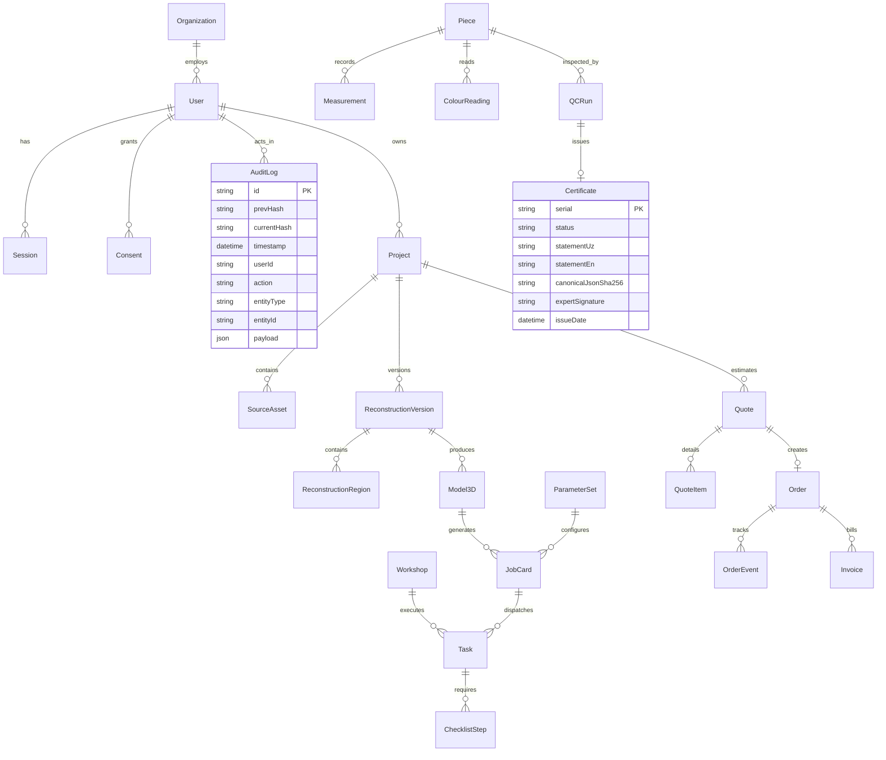

# NaqshLab Data Model & Entity Relationship Specification

## 1. Mermaid Entity-Relationship Diagram

## 2. Core Entities & Attributes

- **User**: ID, email, role (`CLIENT`, `EXPERT`, `WORKSHOP`, `OPERATOR`), name, organizationId, ed25519PublicKey, encryptedEd25519PrivateKey, createdAt.
- **Consent**: ID, userId, projectId, statement, ipHash, consentGiven, timestamp.
- **Project**: ID, clientId, name, location, objectType (`KASHI_TILE`, `GANCH_PANEL`, `MIXED`), periodStyle, notes, consentFlag, allowExternalAi, status (`DRAFT`, `SOURCES_UPLOADED`, `RECONSTRUCTION_REVIEW`, `DESIGN_APPROVED`, `MODEL_READY`, `PRODUCTION_PLANNED`, `IN_PRODUCTION`, `QC`, `CERTIFIED`, `DELIVERED`, `CANCELLED`).
- **SourceAsset**: ID, projectId, assetType, originalFilename, storageKey, sha256Checksum, sizeBytes, mimeType, magicBytesVerified, calibrationData, createdAt.
- **ReconstructionVersion**: ID, projectId, versionNumber, status (`DRAFT`, `IN_REVIEW`, `APPROVED`, `REJECTED`), approvedByUserId, approvedAt, svgData, heightmapStorageKey, dxfStorageKey, metadataJson.
- **ReconstructionRegion**: ID, versionId, regionIndex, bbox, symmetryCandidate, inpaintCandidate, motifCandidate, chosenCandidate, isApproved.
- **Model3D**: ID, reconstructionVersionId, boundingBoxMm, basePlateThicknessMm, reliefDepthMm, volumeMm3, surfaceAreaMm2, estimatedMassKg, meshStorageKeyGlb, meshStorageKeyStl, meshStorageKeyObj, isWatertight, draftAngleWarningsJson.
- **ParameterSet**: ID, route (`KASHI`, `GANCH`, `CNC_DIRECT`), version, shrinkageX, shrinkageY, shrinkageZ, clayPlasterRecipe, glazeRecipe, firingProfileJson, dryingHours, minThicknessMm, tolerancesJson, isFrozen.
- **JobCard**: ID, pieceId, model3dId, parameterSetId, compensatedDimensionsJson, replicaMarkingRequired, replicaMarkingTextUz, replicaMarkingTextEn, replicaMarkingVerifiedPhotoKey, status.
- **Piece**: ID, serial, projectId, model3dId, status, replicaStatementUz, replicaStatementEn.
- **QCRun**: ID, pieceId, inspectorUserId, expertSignedUserId, result (`PASS`, `FAIL`, `EXPERT_REVIEW`), meanDeltaE, maxDeltaE, scanDeviation95thMm, caliperDeviationsJson, signedAt, expertSignature.
- **Certificate**: ID, serial, pieceId, qcRunId, statementUz, statementEn, canonicalJson, canonicalJsonSha256, expertSignature, status (`VALID`, `REVOKED`), revocationReason, revokedAt.
- **PriceRule**: ID, itemType, basePriceUzs, complexityMultiplier, routeSurchargeUzs, mouldFeeUzs, rushMultiplier, active.
- **Quote**: ID, projectId, subtotalUzs, vatPercent, totalUzs, isEstimate, status.
- **Order**: ID, quoteId, projectId, status, paymentScheduleJson, contractPdfStorageKey.
- **AuditLog**: ID, prevHash, currentHash, timestamp, userId, action, entityType, entityId, payload.
